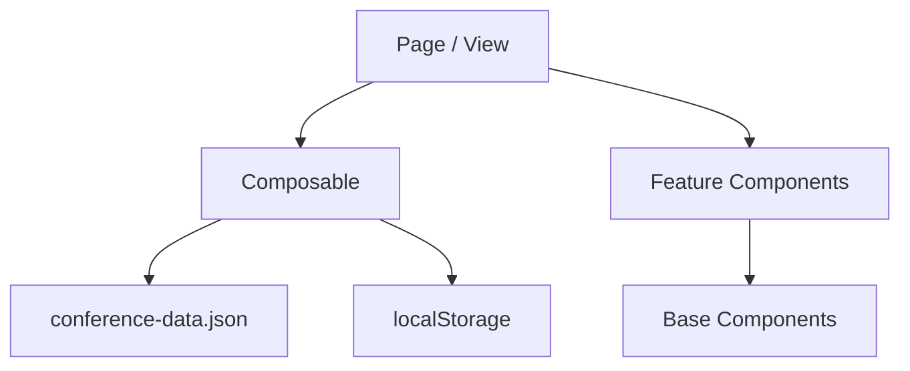

# ADR 02: Komponenten- und Ordnerstruktur

- Status: Akzeptiert
- Datum: 2026-10-11

## Kontext

Die Konferenz-App `FrontendNow` soll als Nuxt-basierte Frontend-Anwendung mit mehreren Seiten, wiederverwendbaren UI-Komponenten und einer klaren fachlichen Struktur umgesetzt werden. Die Datenbasis liegt als statischer Datensatz in `conference-data.json` vor und muss für Übersichten, Speaker-Views und das persönliche Programm genutzt werden.

Das Projekt wächst in mehrere fachliche Bereiche: Startseite, Speaker-Übersicht, Sessions, Filterung und persönliches Programm. Wenn alle Verantwortlichkeiten in Seiten- oder Komponenten-Dateien vermischt werden, entstehen schnell komplexe, schwer wartbare Strukturen. Gleichzeitig muss die Architektur für spätere Erweiterungen offen bleiben, ohne den Aufwand für kleine Änderungen zu erhöhen.

## Alternativen

### Option 1: Monolithische Seitenstruktur
Alle Logik und Darstellung werden direkt in den Seiten-Views abgelegt. Beispiel:

- `pages/index.vue` enthält Hero, Filter, Session-Liste und Datenlogik
- Komponenten sind nur kleine, rein visuellen Helfer

Vorteile:
- schnell zu starten
- wenig Initialaufwand

Nachteile:
- Seiten werden schnell unübersichtlich
- Logik ist schwer wiederverwendbar
- Wiederverwendung zwischen Features ist niedrig
- spätere Erweiterungen erhöhen technische Schulden

### Option 2: Modulare, feature-basierte Struktur mit klaren Schichten
Das Projekt wird nach Verantwortlichkeiten organisiert:

- `components/layout`: globale Layout-Elemente
- `components/features`: feature-spezifische Bereiche wie Filter, Sessions, Program
- `components/base`: wiederverwendbare Bausteine
- `composables`: fachliche Logik, Datenzugriff, Filter- und Auswahllogik
- `types`: zentrale Typdefinitionen
- `assets`: statische Konferenzdaten
- `tokens`: globale Design-Tokens im Repository-Root

Vorteile:
- klare Trennung von UI, Logik und Datenquellen
- gute Wiederverwendbarkeit
- leichte Erweiterbarkeit für neue Features
- einfachere Code-Reviews und Wartung

Nachteile:
- mehr Initialaufwand
- muss von Anfang an konsequent eingehalten werden

## Entscheidung

Wir entscheiden uns für die modulare, feature-basierte Struktur mit klaren Schichten.

Die Anwendung nutzt eine hybride Architektur aus:

- Layout-Komponenten für die globale Präsentation
- Feature-Komponenten für fachliche Bereiche
- Base-/UI-Komponenten für kleine, wiederverwendbare Bausteine
- Composables für wiederverwendbare Zustands- und Datenlogik

### Headless-Abwägung: Session-Filterung

Für die Session-Filterung ist eine Headless-Aufteilung sinnvoll: Suchbegriff und Track-Auswahl sowie die daraus abgeleitete Session-Liste liegen im Composable `useSessionFilter`; `SessionFilterBar` und `SessionCard` übernehmen die Darstellung. So bleibt die Filterlogik unabhängig von der konkreten UI und kann bei Bedarf in weiteren Ansichten verwendet oder separat getestet werden.

Eine vollständig entkoppelte, konfigurierbare Headless-Komponente wäre für die derzeitige Anwendung dagegen unnötig komplex: Es gibt bislang nur eine Filteroberfläche. Deshalb wird die Logik im Composable von der Darstellung getrennt, aber keine zusätzliche Abstraktionsschicht eingeführt.

## Konsequenzen

### Positiv

- Die Seiten bleiben übersichtlich und fokussiert auf Orchestrierung
- Logik kann gezielt wiederverwendet werden
- Features lassen sich einfacher ergänzen und isolieren
- Code bleibt im Laufe der Projektentwicklung konsistenter und wartbarer

### Negativ

- Der Aufbau verlangt eine bewusste Organisation von Anfang an
- Neue Entwickler müssen die Schichten und Namenskonventionen verstehen
- Ein modulares Projekt kann bei sehr kleinen Features zunächst „großer“ wirken

## Ergebnis

Die Architektur ist bewusst so gewählt, dass sie für die Konferenz-App ausreichend flexibel, aber nicht überkomplex ist. Die Aufteilung in Layout-, Feature- und Base-Bereiche entspricht der Nuxt-Logik und schafft eine gute Grundlage für spätere Erweiterungen wie Detailseiten, Personalisierung, Filter-Logik und theming-fähige UI-Komponenten.

