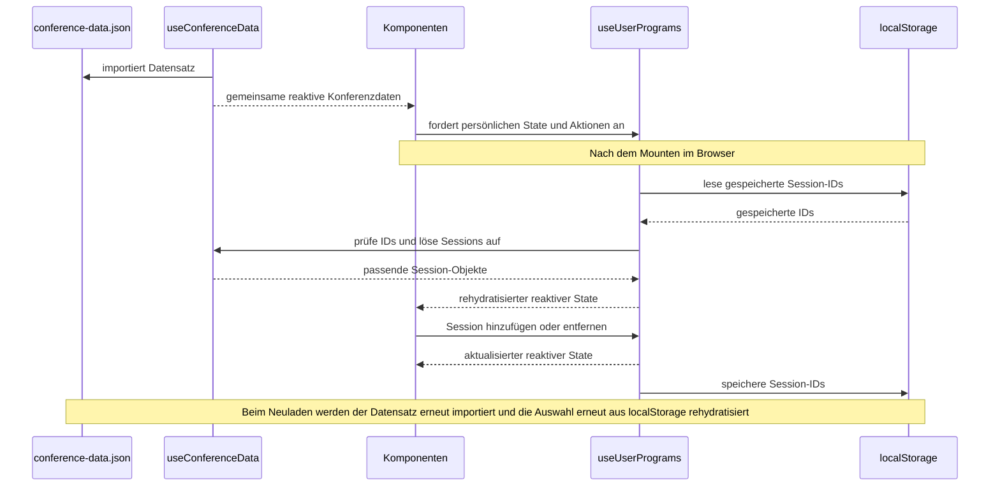

# State-Management-Konzept: Mein Programm

## Kontext

Die Konferenz-App enthält einen geteilten Datensatz (`conference-data.json`) mit Informationen zu Konferenz, Tracks, Räumen, Speakern und Sessions. Dieser Datensatz muss in verschiedenen Bereichen verwendet werden: Startseite, Speaker-Liste, Session-Filterung und persönliches Programm.

Zusätzlich muss ein persönlicher State für `Mein Programm` verwaltet werden. Nutzer:innen sollen Sessions zu ihrer Auswahl hinzufügen oder entfernen können. Diese Auswahl muss nach Seitenwechseln erhalten bleiben und beim Neuladen wiederhergestellt werden.

## Ziel

Die Lösung soll:

- eine zentrale, geteilte Datenquelle für Konferenzdaten haben,
- die Auswahl `Mein Programm` separat von den Basisdaten verwalten,
- die Daten persistieren,
- und alle relevanten Komponenten reaktiv mit denselben Informationen versorgen.

## Datenmodell

### 1. Grunddaten
Die Basisdaten bleiben als readonly-Datensatz in `conference-data.json` hinterlegt. Diese Informationen werden in ein Composable geladen, das sie als zentralen, geteilten State bereitstellt.

```ts
const data = useState<ConferenceData>('conference-data', () => conferenceData)
```

Dadurch werden die Daten:

- einmal geladen,
- global im Nuxt-Context verfügbar,
- und als zentrale Quelle für alle Komponenten genutzt.

### 2. Persönlicher State
Für `Mein Programm` werden nicht die kompletten Session-Objekte gespeichert, sondern nur die relevanten IDs. Das ist sinnvoll, weil:

- die Datenbasis bereits im App-State vorhanden ist,
- redundante Kopien vermieden werden,
- die Persistenz kleiner und einfacher bleibt,
- das Laden und Aktualisieren effizienter ist.

Beispiel:

```ts
['s03', 's08', 's14']
```

Die Session-Objekte werden aus dem zentralen Datensatz durch die ID abgerufen. Damit bleibt die Auswahl logisch und einfach, ohne die ursprünglichen Daten zu duplizieren.

## Persistenz

Die Auswahl wird in `localStorage` gespeichert. Die Persistenz erfolgt als Array von Session-IDs.

Ablauf:

1. `useConferenceData()` stellt den importierten `conference-data.json`-Datensatz als gemeinsamen Nuxt-State bereit.
2. Komponenten rufen die benötigten Konferenzdaten und `useUserPrograms()` auf.
3. Nach dem Mounten im Browser liest `useUserPrograms()` die gespeicherten Session-IDs aus `localStorage`, prüft sie gegen die verfügbaren Sessions und rehydratisiert damit den persönlichen State.
4. Komponenten zeigen die ausgewählten Sessions reaktiv an. Beim Hinzufügen oder Entfernen aktualisiert `useUserPrograms()` den State.
5. Änderungen werden nach abgeschlossener Rehydration als Session-IDs in `localStorage` gespeichert. So überschreibt der initiale leere State die gespeicherte Auswahl nicht.

Beim Neuladen wird der gemeinsame Datensatz erneut aus der importierten JSON-Datei initialisiert; der persönliche State wird im Browser aus `localStorage` wiederhergestellt.

## Reaktiver Datenfluss



## Warum diese Entscheidung?

### Vorteile

- zentrale Datenquelle bleibt unverändert und clean
- `Mein Programm` ist leicht zu persistieren und wiederherzustellen
- Identifikatoren sind performant und Platz sparend
- State bleibt rekonstruierbar aus der vorhandenen Datengrundlage

### Nachteile

- Bei Änderungen an den Session-Daten müssen Referenzen konsistent bleiben
- Die Auswahl basiert auf IDs, daher ist eine saubere Datenmodellierung besonders wichtig

## Entscheidung

Wir speichern im persönlichen Programm nur die Session-IDs und holen die vollständigen Objekte bei Bedarf aus dem zentralen Datensatz. Dadurch bleibt die Architektur konsistent, leicht verständlich und skalierbar.

## Konsequenzen

- Die Datenbasis bleibt Single Source of Truth
- Die Auswahl ist persistenzfreundlich und klein
- Komponenten können reaktiv reagieren, ohne selbst Daten zu verwalten
- Das System lässt sich später problemlos auf weitere persönliche Merkmale erweitern
